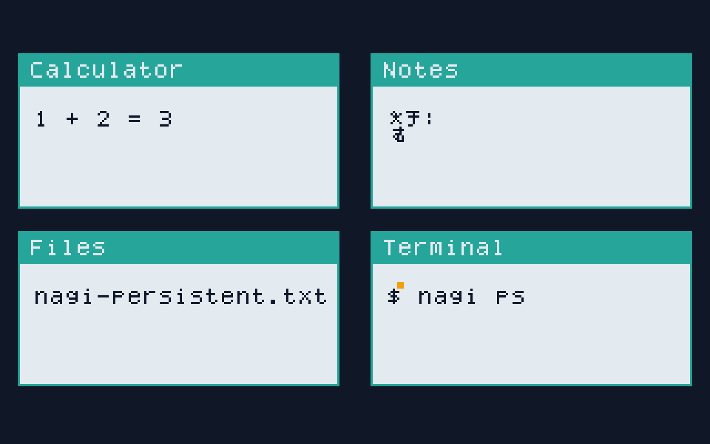
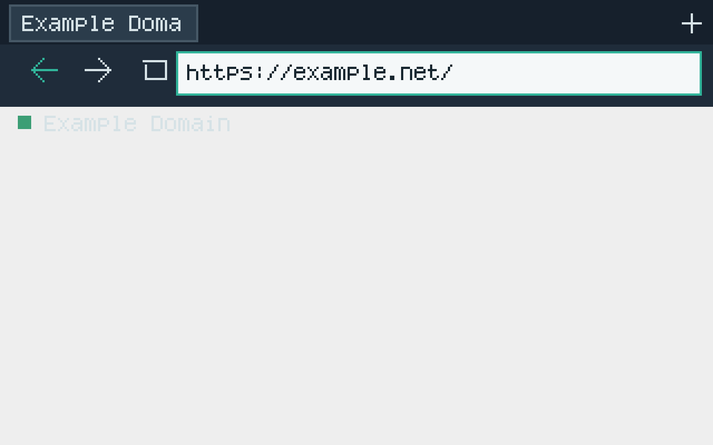
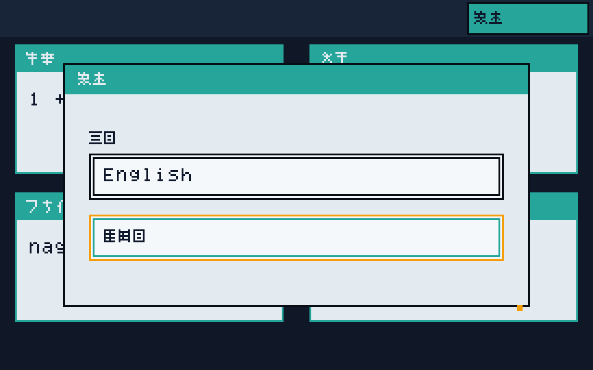

# Nagi OS

**NAGI — Native Agentic General Interface**

[English](README.md) · [日本語](README.ja.md)

> **実験的な Developer Preview です。** Nagi は Linux カーネル上で動く
> Nagi 独自のユーザーランドとして開発中です。0.1 の対象は QEMU x86-64
> 参照マシンであり、完成した汎用 OS や物理 PC 対応を示すものではありません。

所有者が権利を持つ Nagi 独自 OS ソースのうち、明示された範囲を
**MPL-2.0** で提供します。既存パッケージ・外部ソフトウェア・モデルの
ライセンスは維持します。字形・画像等の出自や OS イメージ全体の再配布確認は
未完了です。[ライセンス](#ライセンス)と[適用範囲](LICENSE_SCOPE.md)を参照してください。

## プロジェクト概要

Nagi OS は、Linux カーネルの上で動く Nagi 独自のユーザーランドです。
既存の Linux ディストリビューションは土台にしません。PID 1、システム
サービス、デスクトップ、標準アプリは Nagi のものです。0.1 Developer
Preview の対象は QEMU x86-64 参照マシンです。

Nagi は独自カーネルから始まりましたが、その開発は終了しました
（[DEC-123](docs/product-decisions/DEC-123-kernel-unification-and-linux-0.1.md)）。
M0〜M30 の記録は履歴として残し、Linux 版の受け入れ証拠には使いません。

通常の GUI・キーボード・ポインター操作を大切にしながら、利用者の意図に
沿った作業を AI が支援するローカルファーストのデスクトップを探求します。
AI はユーザー空間で動く信頼されない provider として扱います。状態を変更
する提案は、決定的な検証、ポリシー、Capability、Executor の境界を通す
設計ですが、エンドツーエンドの統合は開発中です。

受け入れ結果と制限の正本は[実装状況](docs/implementation_status.md)です。

## ビジョン

Nagi の開発理念は次のとおりです。

> **安全を既定に。強力な操作は利用者の選択で。**
>
> **制限するのはソフトウェアであり、所有者ではない。**

長期的には、利用者の意図を理解しつつ、マシンの権限を所有者の手元に保つ
AI ネイティブ OS を目指します。AI をカーネルの特権機能にせず、モデルの
確信度によって権限が増えることも認めません。

Local-first / Offline-first は設計の中心です。基本操作をクラウドアカウント、
クラウド LLM、API キー、テレメトリー、リモートストレージに依存させない
ことを目指します。ただし、現在の Preview の全機能・provider がオフライン
受け入れを完了したという意味ではありません。
Albert で外部 Web ページを開くにはネットワーク接続が必要です。

英語と日本語は対等な第一級のユーザー言語です。Nagi OS 0.3 の Personal
Agent 構想では、ユーザー所有の Profile やモデル非依存の Memory へこの
設計を広げます。これは将来のアーキテクチャであり、0.1 の完成機能では
ありません。

## なぜ Nagi OS か

- **OS を OS として作る:** Nagi 独自の PID 1、サービス管理、Identity、
  ストレージの境界、デスクトップとアプリが、汎用ディストリビューション
  なしで Linux カーネル上に直接載ります。
- **利用者が権限を保つ:** ソフトウェアの操作権限を Capability と明示的な
  許可で決め、確率的な AI 出力に権限を与えません。
- **ローカルデータを基本にする:** ユーザーオブジェクト、履歴、将来の AI
  Context はローカル所有と復元可能性を重視します。
- **Agent がなくても使える:** AI が利用できない、または無効な場合も、
  通常の GUI・キーボード・ポインター操作を保つことが要件です。
- **英語と日本語を同等に扱う:** 両言語を第一級のユーザー言語とし、翻訳の
  完成度やアクセシビリティは引き続き整備します。

## 主な特徴

| 分野 | 現在の証拠 | 範囲と制限 |
| --- | --- | --- |
| Linux 上の Nagi PID 1 | [PR #163](https://github.com/Roy-To/NagiOS/pull/163) で、QEMU の開発イメージの受け入れに合格。署名付きの起動入力、サービスのライフサイクルと異常終了後の復旧、集約 READY。 | 開発イメージのみ。製品ビルドの PID 1 には、まだログイン・Data・Notes の経路がありません。起動の連鎖の検証もまだありません。 |
| Identity とセッション | 所有者の登録、誤ったパスワードの拒否を含むログイン、ログアウト、所有者経路での失効、Identity サービス強制終了後の復旧が、同じイメージで合格。 | 別の権限主体による失効は未実装です。 |
| Notes と永続 Data | 書き込み可能な Data ディスクに Notes を保存し、再起動後に開き直して内容がバイト単位で一致。System ディスクへの書き込みは拒否。 | Linux イメージの標準アプリは、今のところ Notes だけです。 |
| 応答性 | 8 GiB / 4 vCPU の TCG ゲストで、キー入力から表示までの中央値は約 41〜43 ms（目標 50 ms、DEC-116）。 | debug ビルドの PID 1 での測定です。 |
| 英語と日本語 | どちらも第一級のユーザー言語です。 | Linux のデスクトップ、Settings、全体の翻訳は今後の 0.1 マイルストーンです。 |
| Personal Agent | Nagi 0.3 のアーキテクチャで、Profile、モデル非依存の Memory、学習、Capability を考慮した Agent 実行を記述しています。 | 将来のロードマップであり、0.1 の実装ではありません。 |

## アーキテクチャ

~~~text
Linux カーネル
    ↓
Nagi PID 1（nagi-init）— 署名付き boot catalog、サービス管理、復旧
    ↓
Nagi システムサービス — Identity、ストレージの所有、IPC
    ↓
Nagi デスクトップと標準アプリ
~~~

PID 1 は署名付きの boot catalog とサービスのパッケージを検証し、システム
サービスを専用の名前空間と seccomp フィルターの下で起動します。各サービスの
ライフサイクルを記録し、異常終了したときは次の起動で復旧します。アプリが
利用者のデータに触れられるのは、ログイン中のプロファイルに与えられた保存先
だけです。一部は開発イメージでの動作です。PR #163 の範囲の注記を参照して
ください。

設計の契約は[アーキテクチャ概要](docs/architecture/README.md)と
[製品決定](docs/product-decisions/README.md)を参照してください。

## 現在の開発状況

Linux 版は最初の統合を終えました（[PR #163](https://github.com/Roy-To/NagiOS/pull/163)）。
L0〜L6 は QEMU の開発イメージで受け入れに合格しています。0.1 の残りは
[ROADMAP.md](ROADMAP.md) の L7〜L12（デスクトップの基本、Files、Settings、
Calendar、製品ビルドの固め、配布物）です。

以前の独自カーネル版のマイルストーン M0〜M30 は履歴の記録です。結果は
[docs/implementation_status.md](docs/implementation_status.md) に残しており、
Linux 版の状態を示すものではありません。

Nagi は製品としてのセキュリティを保証しません。[SECURITY.md](SECURITY.md)
を参照してください。

## スクリーンショット

以下は以前の独自カーネル版（M10、M18、M29）の画像で、Linux 版のものでは
ありません。各画像が示すのは、キャプションに記したチェックポイントです。

| M10 — ネイティブデスクトップ | M18 — Albert / Servo |
| --- | --- |
|  |  |
| 固定パネルの受け入れ画面で、完成したアプリ群ではありません。 | 2026-10-01 撮影。2026-10-07 の M18 全操作 CI 受け入れより前の画像です。ページ描画の静止画で、全ブラウザー操作を示すものではありません。 |

### M29 — 日本語 Settings

言語選択と同じ User Data を使った再起動後の復元に対応する受け入れ画像です。
全 UI の翻訳やアクセシビリティを示すものではありません。

この準備作業では動画を撮影・公開していません。
[QEMU 動画撮影計画](docs/oss/demo-recording-plan.md)では、再確認した
ゲスト動作を撮影する手順をまとめています。

## ロードマップ

- **Nagi OS 0.1 — Developer Preview（Linux 版）:** Linux カーネル上で、
  範囲を絞った最初のリリースです。起動、ログイン、デスクトップの基本、
  Notes・Files・Settings・Calendar、検証済みの配布物。L0〜L6 は合格し、
  L7〜L12 が残っています。
- **Nagi OS 0.2 — Platform Foundation:** ブラウザー、ローカル AI、音声、
  意味検索、A/B 起動と復旧などです。開始の条件は Linux 版 0.1 Developer
  Preview の公開です（DEC-123）。
- **Nagi OS 0.3 — Agentic System:** ユーザー所有の Profile / Memory、
  モデル移行性、Capability を考慮した操作、Wayback による Undo を備える
  Personal Agent の将来アーキテクチャです。
- **Nagi OS 1.0:** 正式な公開 OSS リリースの長期目標です。日程は未定です。

[ROADMAP.md](ROADMAP.md) と、改訂済みの 0.3・0.4+・0.5–1.0 ロードマップ
および長期ビジョンをまとめた[製品決定](docs/product-decisions/README.md)を
参照してください。

## はじめ方

Nagi 0.1 の対象は QEMU x86-64、仮想 CPU 4 基、RAM 8 GiB です。pinned Rust
toolchain とリポジトリに記載されたホスト依存関係を使ってください。物理 PC
対応は 0.1 の完了要件ではありません。

`./nagi` コマンドは Linux 版に合わせて更新中です。以前の独自カーネルを
ビルド・起動していたコマンドは削除し、`./nagi run` は Linux の開発イメージを
起動するようになります。その変更が入るまでは、ホスト上の確認は次で行えます。

~~~sh
./nagi doctor
./nagi fetch
./nagi test --acceptance --host-only
~~~

Linux の開発イメージは [tools/linux-boot](tools/linux-boot) のスクリプトで
ビルド・起動します。最新の手順は[Developer Preview ガイド](docs/developer-preview/README.md)
と <code>./nagi --help</code> で確認してください。

公開リポジトリであること自体は、明示された適用範囲を超える権利を
付与しません。利用・再配布は [LICENSE_SCOPE.md](LICENSE_SCOPE.md) と
[LICENSE](LICENSE) に示す範囲に従い、除外対象と第三者素材にはそれぞれの条件と
通知が適用されます。

## コントリビューション

ChatGPT／Codex／Claudeを使って参加する方は、
[共同開発者向けオンボーディングガイド](docs/development/co-developer-onboarding-ja.md)から始めてください。

[CONTRIBUTING.md](CONTRIBUTING.md)、[AGENTS.md](AGENTS.md)、
[現在の実装状況](docs/implementation_status.md)、変更を担当する
workstream を先に確認してください。受け入れ証拠は source revision と
結び付け、確認済みの動作、部分実装、将来計画を分けて記録します。

再現可能な QEMU の不具合報告、範囲を絞った修正、ドキュメントの改善、
証拠や未完了項目を明らかにするレビューが役立ちます。コードを送る前に、
下記のライセンス条件とコントリビューション手順を確認してください。

このドキュメントは OSS 公開と Codex for Open Source 応募の準備です。
[応募準備メモ](docs/oss/codex-application-preparation.md)に、プロジェクト説明、
支援の用途、maintainer が確認する事項をまとめています。
応募の送信や採択を示すものではありません。

## ライセンス

所有者が権利を持つ Nagi 独自 OS ソースのうち、[LICENSE_SCOPE.md](LICENSE_SCOPE.md)
に記載した対象を **[MPL-2.0](LICENSE)** で提供します。単なる採用候補ではなく、
対象ソースへの利用許諾です。ただし、リポジトリ内の全ファイルや OS イメージ全体が
MPL 対象・再配布確認済みという意味ではありません。

`tools/nagi-cli`、`tools/legal`、`crates/nagi-embedding-provider`、
`crates/nagi-tts-provider` の既存 `MIT OR Apache-2.0` 表記は維持します。
第三者ソフトウェアやモデルにも元の条件が残ります。Granite・Qwen の対象モデルは
Apache-2.0 と記録されていますが、Gemma は Google 独自規約です。
今回のライセンス整備ではモデル重みを配布しません。

埋め込み字形の出自が未確認の `user/nagi-init/src/font.rs` や画像・データ類は、
今回の新たな許諾に含めません。[レビュー記録](docs/oss/mpl-2.0-scope-review.md)に、
確認した資料、確認できなかった範囲、未解決事項を明記しています。
OS イメージ・ソース一式の再配布確認と 0.1 の完成判定は、引き続き別の作業です。

[THIRD_PARTY_NOTICES.md](THIRD_PARTY_NOTICES.md)と
[過去の Apache-2.0 準備監査](docs/oss/apache-2.0-readiness.md)の依存関係に関する
指摘は残ります。過去の Nagi 本体のライセンス候補に関する記述だけを
LICENSE_SCOPE.md で更新し、未解決の出自・通知義務まで解決扱いにはしません。

その他: [ロードマップ](ROADMAP.md) · [リリースノート](RELEASE_NOTES.md) ·
[依存関係／SBOM ツール](docs/legal/README.md)
