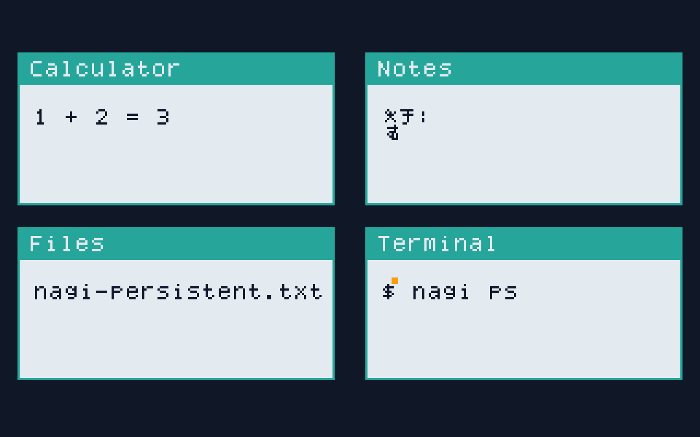
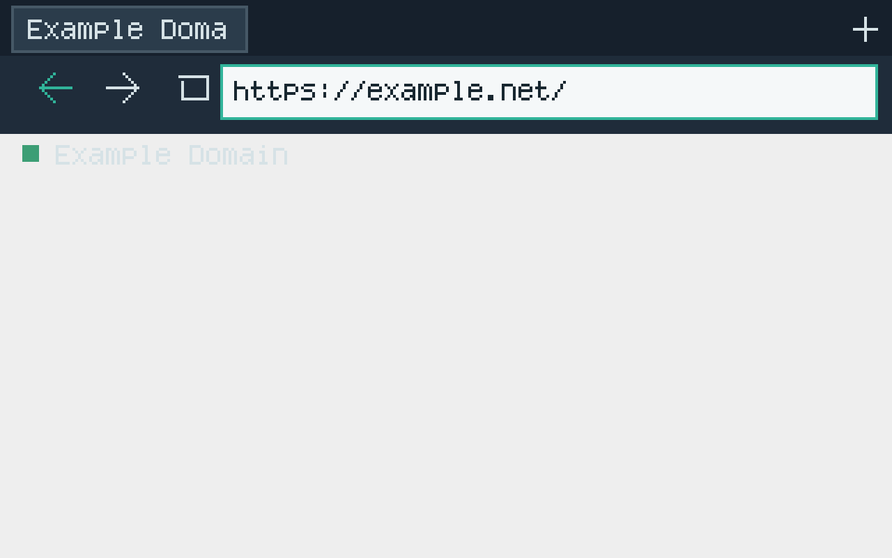
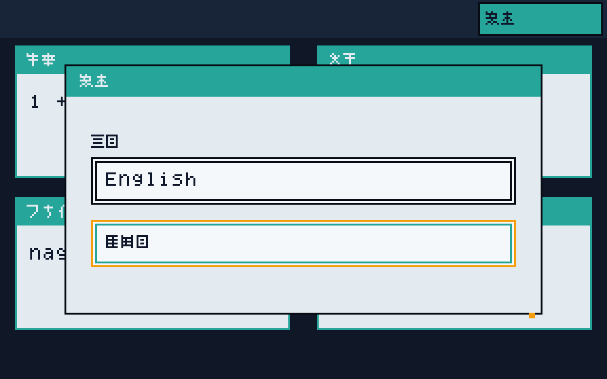

# Nagi OS

**NAGI — Native Agentic General Interface**

[English](README.md) · [日本語](README.ja.md)

> **Experimental Developer Preview.** Nagi is a Nagi-owned userland on the
> Linux kernel, under active development. The 0.1 target is the QEMU x86-64
> reference machine; this repository does not claim a finished, general-purpose
> OS or physical-PC support.

The maintainer's original Nagi OS source within the documented scope is licensed
under **MPL-2.0**. Existing package licenses and third-party/model terms remain
separate. Some glyph/media provenance and complete-image redistribution checks
remain unresolved. See [Licensing](#licensing) and [LICENSE_SCOPE.md](LICENSE_SCOPE.md).

## Project Overview

Nagi OS is a Nagi-owned userland running on the Linux kernel. Nagi does not use
an existing Linux distribution as its base: PID 1, system services, the desktop
and first-party apps are Nagi's own. The 0.1 Developer Preview targets the QEMU
x86-64 reference machine.

Nagi started as a from-scratch operating system with its own kernel. That work
has ended
([DEC-123](docs/product-decisions/DEC-123-kernel-unification-and-linux-0.1.md));
its milestone records M0–M30 are kept for history and are not evidence for the
Linux line.

The project explores a local-first desktop where normal keyboard, pointer, and
GUI use remains central while AI can help with user-directed work. The AI
design keeps models in user space and treats their output as untrusted. The
design requires proposed state changes to pass deterministic validation,
policy, capability, and executor boundaries; end-to-end integration remains
under development.

The milestone record in [implementation status](docs/implementation_status.md)
is the source of truth for acceptance results and known limits.

## Vision

Nagi is guided by:

> **Safe by default. Powerful by choice.**
>
> **Restrict software, not the owner.**

The long-term vision is an AI-native operating system that understands user
intent while keeping authority with the person who owns the machine. AI should
be useful without becoming a privileged kernel component or gaining authority
from its confidence.

Local-first and offline-first are core design goals: basic operation should not
depend on a cloud account, cloud LLM, API key, telemetry service, or remote
storage. This is a product direction; it does not mean every current preview
feature or provider has completed offline acceptance.
Opening external web pages in Albert still requires a network connection.

English and Japanese are equal first-class user-language commitments. The
planned Nagi OS 0.3 Personal Agent builds on these boundaries with user-owned,
model-independent profile and memory concepts. That agent experience is a
future architecture, not a completed 0.1 feature.

## Why Nagi OS?

- **An operating system built as an operating system:** Nagi's own PID 1,
  service supervisor, identity, storage boundaries, desktop and apps run on the
  Linux kernel, without a general-purpose distribution underneath.
- **The user keeps authority:** capabilities and explicit permissions define
  what software can do; probabilistic AI output does not grant access.
- **Local data is the default direction:** user objects, history, and planned
  AI context are designed around local ownership and recoverability.
- **Useful without an agent:** ordinary GUI, keyboard, and pointer interaction
  remains a requirement even when AI is unavailable or disabled.
- **Designed for English and Japanese:** both are first-class user languages,
  with broader localization and accessibility work still in progress.

## Key Features

| Area | Current evidence | Scope and limits |
| --- | --- | --- |
| Nagi PID 1 on Linux | [PR #163](https://github.com/Roy-To/NagiOS/pull/163) passed development-image acceptance on QEMU: signed boot inputs, service lifecycle and recovery after abnormal exit, and an aggregate READY signal. | Development image only. Release builds of PID 1 do not yet include the login, Data and Notes paths. There is no verified boot chain yet. |
| Identity and sessions | Owner registration, login with rejection of a wrong password, logout, owner-path revocation, and recovery after the Identity service is killed passed on the same image. | Revocation by a different authority is not implemented. |
| Notes and persistent Data | Notes saved, reopened after reboot, and matched byte-for-byte on a writable Data disk; the System disk rejected writes. | Notes is the only first-party app on the Linux image so far. |
| Responsiveness | Median key-to-present latency of about 41–43 ms on an 8 GiB / 4 vCPU TCG guest (target: 50 ms, DEC-116). | Measured on a debug-profile PID 1. |
| English and Japanese | Both are first-class user languages. | The Linux desktop, Settings and full translation are future 0.1 milestones. |
| Personal Agent | Nagi 0.3 architecture work describes profile, model-independent memory, learning, and capability-aware agent execution. | This is a forward roadmap, not a 0.1 implementation claim. |

## Architecture

~~~text
Linux kernel
    ↓
Nagi PID 1 (nagi-init) — signed boot catalog, service supervisor, recovery
    ↓
Nagi system services — Identity, storage ownership, IPC
    ↓
Nagi desktop and first-party apps
~~~

PID 1 verifies the signed boot catalog and service packages, starts system
services in their own namespaces with seccomp filters, and records each
service's lifecycle so that the next boot can recover from an abnormal exit.
Apps reach user data only through storage granted for the signed-in profile.
Some of this is development-image behavior; see the scope notes in PR #163.

For the design contracts, see the [architecture overview](docs/architecture/README.md)
and the [product decisions](docs/product-decisions/README.md).

## Current Development Status

The Linux line has completed its first integration
([PR #163](https://github.com/Roy-To/NagiOS/pull/163)): milestones L0–L6 passed
development-image acceptance on QEMU. The remaining 0.1 work is listed in
[ROADMAP.md](ROADMAP.md) (L7–L12: desktop basics, Files, Settings, Calendar,
release hardening, and release artifacts).

The earlier custom-kernel milestones M0–M30 are historical records. Their
results are kept in [docs/implementation_status.md](docs/implementation_status.md)
and do not describe the Linux line.

Nagi makes no production security guarantees; see [SECURITY.md](SECURITY.md).

## Screenshots

These are historical captures from the earlier custom-kernel line (M10, M18,
M29), not the Linux line. Each image shows only the checkpoint named in its
caption.

| M10 — Native desktop | M18 — Albert / Servo |
| --- | --- |
|  |  |
| Fixed desktop acceptance panels; not a completed app suite. | Captured 2026-10-01, before M18's full interactive CI closure on 2026-10-07. The still shows a rendered page, not all browser interactions. |

### M29 — Japanese Settings

This image accompanies the QEMU language-selection and same-disk restart
acceptance. It does not demonstrate complete translation or accessibility.

No demo video has been recorded or published by this preparation. The
[QEMU demo recording plan](docs/oss/demo-recording-plan.md) describes a
recording based on reverified guest behavior.

## Roadmap

- **Nagi OS 0.1 — Developer Preview (Linux):** a narrow first release on the
  Linux kernel: boot, login, desktop basics, Notes, Files, Settings and Calendar,
  and verified release artifacts. L0–L6 have passed; L7–L12 remain.
- **Nagi OS 0.2 — Platform Foundation:** browser, local AI, voice, semantic
  search, and A/B boot and recovery, among others. Activation requires the
  Linux 0.1 Developer Preview to be published (DEC-123).
- **Nagi OS 0.3 — Agentic System:** a forward architecture for a Personal Agent
  with user-owned profile and memory, model portability, capability-aware
  actions, and Wayback-backed undo.
- **Nagi OS 1.0:** the long-term target for formal public OSS release. No
  release date is promised.

See [ROADMAP.md](ROADMAP.md) and the
[product decisions](docs/product-decisions/README.md) for the revised 0.3, 0.4+
and 0.5–1.0 roadmaps and the long-term vision.

## Getting Started

Nagi 0.1 targets QEMU x86-64 with four virtual CPUs and 8 GiB of RAM. Use the
pinned Rust toolchain and the host dependencies listed by the repository.
Physical PC support is not a 0.1 completion requirement.

The `./nagi` command line is being updated for the Linux line. Commands that
built and booted the earlier custom kernel are being removed, and `./nagi run`
will start the Linux development image. Until that change lands, the host
checks still work:

~~~sh
./nagi doctor
./nagi fetch
./nagi test --acceptance --host-only
~~~

The Linux development image is built and started with the scripts under
[tools/linux-boot](tools/linux-boot). For current details, follow the
[Developer Preview guide](docs/developer-preview/README.md) and run
<code>./nagi --help</code>.

Public visibility alone does not grant rights beyond the scoped source license.
Use and redistribution follow [LICENSE_SCOPE.md](LICENSE_SCOPE.md), [LICENSE](LICENSE),
and the applicable exclusions, third-party terms, and notices.

## Contributing

Japanese collaborators using ChatGPT, Codex, or Claude can start with the
[co-developer onboarding guide](docs/development/co-developer-onboarding-ja.md).

Start with [CONTRIBUTING.md](CONTRIBUTING.md),
[AGENTS.md](AGENTS.md), the current
[implementation status](docs/implementation_status.md), and the workstream
that owns the change. Keep acceptance evidence tied to its source revision and
separate verified behavior from plans and partial implementations.

Useful contributions include reproducible QEMU failures, focused fixes,
documentation improvements, and reviews that identify concrete evidence or
remaining limits.

Community guidance: [Code of Conduct](CODE_OF_CONDUCT.md) ·
[Accessibility](ACCESSIBILITY.md) · [Contributing](CONTRIBUTING.md) ·
[Security](SECURITY.md) · [License](LICENSE).

This documentation prepares Nagi for OSS publication and a Codex for Open Source
application. The [application preparation notes](docs/oss/codex-application-preparation.md)
describe the project, proposed use of support, and outstanding maintainer checks.
They are preparation material, not an application submission or acceptance claim.

Check the licensing terms below and the repository's
contribution instructions before submitting code.

## Licensing

The maintainer's original Nagi OS source identified in
[LICENSE_SCOPE.md](LICENSE_SCOPE.md) is licensed under **[MPL-2.0](LICENSE)**.
This is a scoped source grant, not a claim that every repository file, image,
model or dependency is covered by MPL or cleared for redistribution.

The existing `MIT OR Apache-2.0` declarations in `tools/nagi-cli`, `tools/legal`,
`crates/nagi-embedding-provider` and `crates/nagi-tts-provider` are preserved.
Third-party software and model artifacts retain their own terms. Granite and
Qwen artifacts are recorded as Apache-2.0; Gemma has separate Google terms.
No model weights are redistributed by this licensing change.

Known holds include `user/nagi-init/src/font.rs` (embedded glyph provenance),
media and artifact-specific notices. They are not silently included in the new
grant. The [scope review](docs/oss/mpl-2.0-scope-review.md) describes the reviewed
evidence and its limits. Complete-image/source-bundle redistribution review and
Nagi 0.1 release acceptance remain separate work.

[Third-party notices](THIRD_PARTY_NOTICES.md) and the
[historical Apache-2.0 audit](docs/oss/apache-2.0-readiness.md) retain their
dependency findings. Their old project-license proposal is superseded by
LICENSE_SCOPE.md, not their unresolved provenance and notice requirements.

More: [Roadmap](ROADMAP.md) · [Release notes](RELEASE_NOTES.md) ·
[Dependency/SBOM tooling](docs/legal/README.md)
